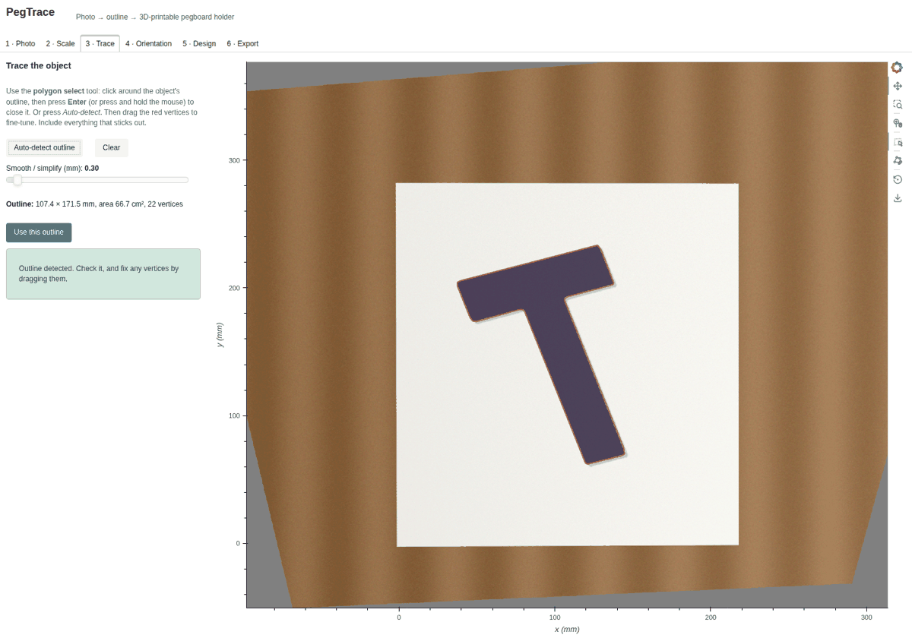
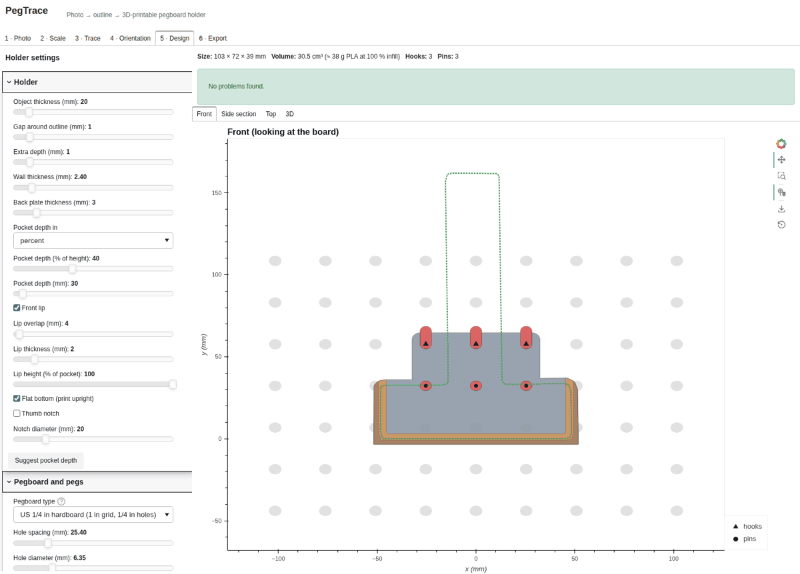
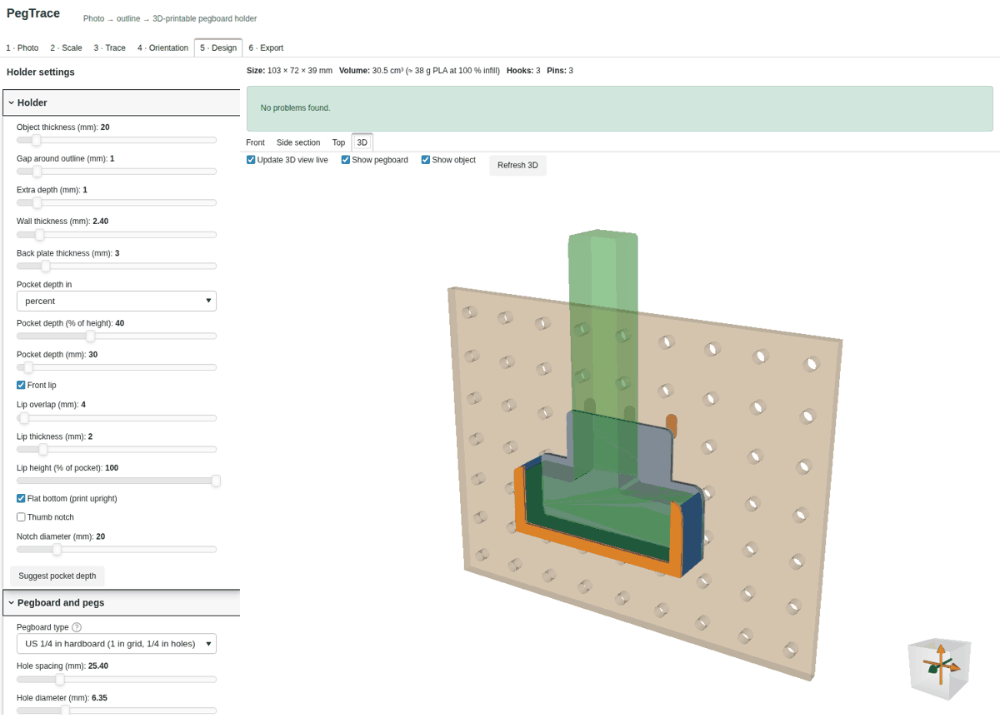

# PegTrace

Photograph an object next to a scale reference, trace its outline, choose which way is down, and get a
3D-printable **pegboard holder** (STL) that supports the object against gravity.

PegTrace is a [Panel](https://panel.holoviz.org) app with [HoloViews](https://holoviews.org) plots. It runs
locally with `panel serve`, or as a **fully static web page** with Python running in the browser (see
[Static site](#static-site)).

| Trace | Design | 3D |
|---|---|---|
|  |  |  |

## Workflow

1. **Photo**: upload a photo, or try the built-in sample.
   - Lay the object flat on a sheet of paper (or next to a ruler) and shoot from roughly above.
   - All four paper corners must be visible.
2. **Scale**: two choices.
   - *Rectangle*: drag four points onto the paper corners. They are placed automatically when the paper is
     found. Pick the paper size (Letter, A4, Legal, A5, A3, a credit card or a custom size). The photo is
     perspective-corrected, so the camera doesn't need to be exactly overhead.
   - *Two points*: mark two ruler marks a known distance apart. This gives scale only, with no perspective
     correction.
3. **Trace**: click around the object, or press **Auto-detect**.
   - Each click adds a vertex, and the outline closes itself.
   - Drag a vertex to move it. Click on an edge to add a vertex there.
   - To delete a vertex, click it and press **Backspace**, or use *Remove last point*.
   - A slider smooths or simplifies the outline.
4. **Orientation**: pick the mount style, then set the arrow.
   - **Flat**: the object hangs against the board, in a pocket-style cradle or (Design step) a ring
     around a narrow part. The arrow points *down*.
   - **Shelf**: the outline becomes a pocket in a shelf that sticks out from the board. The arrow points
     *toward the board*.
   - *Auto* makes the long axis vertical, with the heavier end down.
5. **Design**: adjust the holder and pegboard settings.
   - Front, side-section, top and 3D views update live.
   - Warnings flag a shallow pocket, a single hook, an object that can tip out, and similar problems.
   - *Suggest pocket depth* finds the smallest pocket that holds the object securely.
6. **Export**: download the STL, either upright for printing or in mounted orientation. You can also save or
   load a project file that holds the photo, reference points, outline and all settings.

## How the holder is designed

Coordinates: x runs along the board, y is up and z points out of the board. **P** is the traced outline,
rotated so that gravity points to −y.

**Flat mode**
- `Pc = P` grown by the clearance. `U = sweep_up(Pc)` is the Minkowski sum of Pc with a vertical segment:
  every point the object passes through while it is lifted straight out. **No material is placed inside U**,
  so the object can always be removed upwards, and the cavity has no overhangs when printed upright.
- Walls are the clearance outline grown by the wall thickness, clipped at the pocket top, minus U. They extrude
  over the object's thickness, in front of a back plate.
- An optional **front lip** in front of the object stops it tipping forward. It leaves a window and never
  blocks the lift-out path.
- **Flat bottom** sweeps everything down to a common floor, so the part prints standing up with no supports.
- **Stability check**: the outline is dropped onto the walls. The part then checks two things: whether the
  centroid sits between the contact points, and how far a bump can rotate the object about each contact
  before the walls catch it.

**Flat mode, ring style**

For objects with a wide part above a narrow one (a hammer head-up, a T, pliers by the joint), a full pocket
isn't needed.
- The ring top is placed automatically at the level where something above sticks out furthest past
  everything below, relative to the ring's width. You can also place it at the pocket depth instead.
- A band of walls, plus the back plate and a closed front bar, circles the narrow part. The wide part rests
  on the band, and everything below hangs free through it.
- The band's underside slopes back to the board at about 50° from horizontal, so it still prints upright
  without supports.
- *Auto* on the Orientation step picks whichever way up a ring can hold.

**Shelf mode**
- The footprint (grown by the clearance) is cut into a shelf slab, either as a pocket of the chosen depth or
  all the way through for shafts.
- The shelf runs back into the back plate. An optional rim and end gussets sit on top of the shelf, so the
  part prints as mounted with no supports.

**Pegs**
- The pegs sit on the board's hole grid. They are centred on the back plate, with auto or fixed columns, using
  every Nth hole.
- The top row has **L-hooks**: a teardrop or round peg goes through the board, then a rod rises behind it.
- An optional lower row of straight **anti-tilt pins** has chamfered tips.
- Board presets: US 1/4″ (1″ grid, 1/4″ holes), US 1/8″ (1″ grid, 3/16″ holes), metric 25 mm, or custom.

All solids are combined with [Manifold](https://github.com/elalish/manifold), so every export is a single
watertight mesh.

## Running locally

The project uses the `peg` micromamba environment, with packages from conda-forge plus `manifold3d` from pip.

```bash
micromamba install -n peg -c conda-forge panel holoviews bokeh param numpy pillow contourpy shapely pytest
~/micromamba/envs/peg/bin/python -m pip install manifold3d

cd peg-trace
PYTHONPATH=src ~/micromamba/envs/peg/bin/panel serve web/app_entry.py --show
# or, after `pip install -e . --no-deps`:  pegtrace
```

## Static site

`web/build.py` turns the same app into a static page.
- Python runs in the browser through [pyjs](https://github.com/emscripten-forge/pyjs), using packages from
  [emscripten-forge](https://prefix.dev/channels/emscripten-forge-4x).
- 3D booleans use Manifold's WASM build (`manifold-3d` from npm). `pegtrace/csg.py` switches between the
  Python and JS backends automatically.

```bash
micromamba install -n peg -c conda-forge empack                # packs the browser environment
~/micromamba/envs/peg/bin/python web/build.py              # first run creates build/wasm-env (emscripten-wasm32)
~/micromamba/envs/peg/bin/python web/build.py --app-only   # later: repack only pegtrace + page (seconds)
python -m http.server -d build/dist 8000                   # then open http://localhost:8000
```

Deploy the contents of `build/dist/` to any static host. The first visit downloads about 38 MB:
- the pyjs runtime, about 19 MB;
- the Python packages, about 21 MB, trimmed by `web/empack_config.yaml`.

BokehJS, Panel's JS, vtk.js and manifold-3d load from public CDNs.

Notes on the browser runtime:
- **Panel version.** The browser runs Panel 1.8 / Bokeh 3.9, because Panel 1.10 needs `nh3`, which has no WASM
  build. The app avoids newer Panel features.
- **`webshim.py`.** It adapts Panel's Pyodide-oriented browser code to pyjs: the `js`/`pyodide` modules, JS↔Python
  conversion, and proxies.
- **3D view.** It uses a pure-Python `.vtkjs` scene writer (`pegtrace/vtkjs.py`) shown in Panel's VTKJS pane.
  `vtk`'s Python bindings and `pyvista` aren't available in the browser.

## Tests

```bash
~/micromamba/envs/peg/bin/python -m pytest                      # unit + headless UI tests
~/micromamba/envs/peg/bin/python web/e2e.py --serve             # Playwright run against `panel serve`
~/micromamba/envs/peg/bin/python web/e2e.py --dist build/dist   # same run against the static site
```

The end-to-end test drives every step with real clicks:
- loads the sample photo and calibrates;
- clicks an outline by hand, splits an edge and drags a vertex, then auto-detects the outline;
- picks an orientation and checks the views, including Shelf mode and the ring style;
- switches to the dark theme;
- downloads the STL;
- saves the project and loads it back;
- fails on any browser console error.

Screenshots go to `build/e2e/`. `web/browser_check.py` is a lighter headless-Firefox smoke check that needs no
Playwright.

## Layout

```
src/pegtrace/
  calibration.py  homography, perspective rectification, paper-corner finder
  tracing.py      outline cleanup, auto-detect, orientation
  geom2d.py       shapely helpers (sweeps, clipping)
  csg.py          Manifold adapter: Python manifold3d or JS manifold-3d
  pegs.py         peg layout and solids
  holder_flat.py  flat-mode holder        holder_shelf.py  shelf-mode holder
  stability.py    rest position / tip checks, pocket-depth suggestion
  preview.py      HoloViews views, 3D scene      vtkjs.py  .vtkjs writer + pane
  export.py       binary STL                     state.py  app state, project files
  app.py, ui/     Panel UI (one module per step)
  webshim.py, compat.py   browser-runtime adapters
web/              static build, page template, e2e and smoke tests
```

## Limitations

- The photo gives only the outline, so the object's thickness (Flat mode) and the pocket depth (Shelf mode)
  are entered by hand.
- Thick objects photographed from above look slightly larger than they are, because of parallax. Increase
  the gap setting if the fit is tight.
- Only round-hole pegboard is supported.
