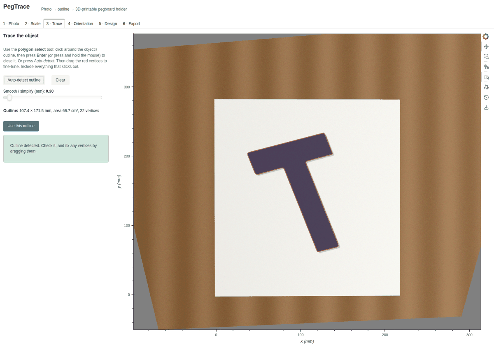
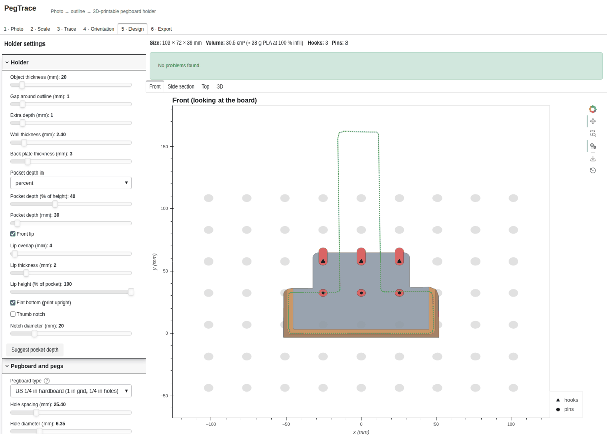
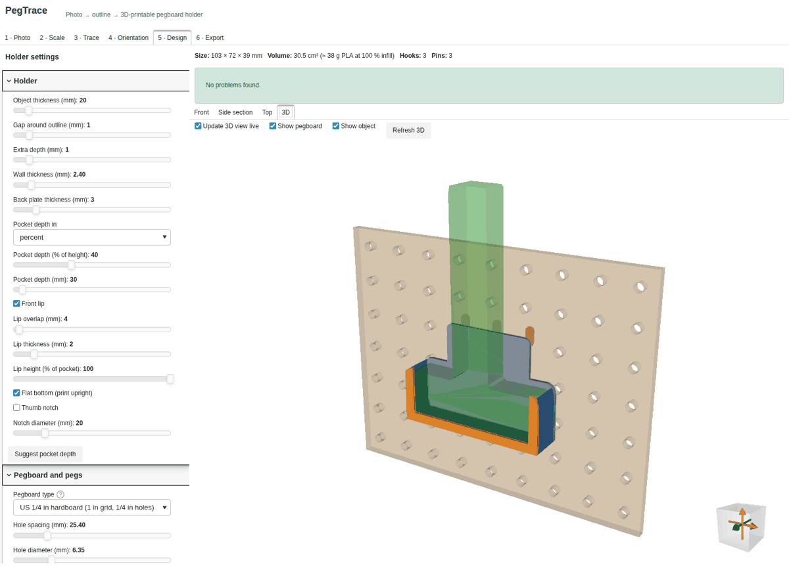

# PegTrace

Photograph an object next to a scale reference, trace its outline, choose which way is down, and get a
3D-printable **pegboard holder** (STL) that supports the object against gravity.

PegTrace is a [Panel](https://panel.holoviz.org) app with [HoloViews](https://holoviews.org) plots. It runs
locally with `panel serve`, or as a **fully static web page** with Python running in the browser (see
[Static site](#static-site)).

| Trace | Design | 3D |
|---|---|---|
|  |  |  |

## Workflow

1. **Photo**: upload a photo (JPEG, PNG, HEIC and others). HEIC photos, as iPhones take them, are converted
   to JPEG in the browser; the converter loads from the internet the first time.
   - Lay the object flat on a sheet of paper (or next to a ruler) and shoot from roughly above.
   - All four paper corners must be visible.
2. **Scale**: two choices.
   - *Rectangle*: drag four points onto the paper corners. They are placed automatically when the paper is
     found. Pick the paper size (Letter, A4, Legal, A5, A3, a credit card or a custom size). The photo is
     perspective-corrected, so the camera doesn't need to be exactly overhead.
   - *Two points*: mark two ruler marks a known distance apart. This gives scale only, with no perspective
     correction.
3. **Trace**: three ways to get the outline.
   - Use the **polygon select** tool: click around the object, then press **Enter** (or press and hold) to
     close the polygon.
   - Or press **Auto-detect**. It merges the points of rounded corners into one point each.
   - Then use the **poly edit** tool (far right of the image) to refine the outline: click and hold on the
     red polygon to make its vertices appear, then drag them. A slider smooths or simplifies it; edited
     points are kept exactly.
4. **Orientation**: pick the mount style, then set the arrow.
   - **Flat**: the object hangs against the board, in a ring around a narrow part or a pocket around its
     bottom. The arrow points *down*.
   - **Shelf**: the outline becomes a pocket in a shelf that sticks out from the board. The arrow points
     *toward the board*.
   - *Auto* makes the long axis vertical, the way up that a ring can hold (a wide part above a narrow
     one) if there is one, else the heavier end down.
5. **Design**: adjust the holder and pegboard settings. Drag a slider, or type an exact value in the box
   next to its name.
   - A labelled diagram above each group of settings shows what each one changes (the flat holder, the
     shelf, and the pegs).
   - Changing a setting doesn't rebuild the holder straight away (it takes seconds on the static site).
     Press **Update holder** to see the front, side-section, top and 3D views with the new settings.
     Exporting, or *Continue to export*, rebuilds first if settings changed.
   - Warnings flag a shallow pocket, a ring the object slides through, a single hook, an object that can
     tip out, and similar problems.
   - A new outline or direction sets **Top Y** and **Bottom Y** to a suggestion (see below); *Suggest Top Y
     and Bottom Y* does it again.
6. **Export**: download the STL, standing upright ready to print (turn it in your slicer if you like). You
   can also save or load a project file that holds the photo, reference points, outline and all settings.
   Type a name for each file before downloading it. Untick *Include the photo* for a project file of a
   few KB instead of a few hundred; it still holds the outline and settings, so it makes the same holder.

## How the holder is designed

Coordinates: x runs along the board, y is up and z points out of the board. **P** is the traced outline,
rotated so that gravity points to −y.

**Flat mode**
- `Pc = P` grown by the clearance. `U = sweep_up(Pc)` is the Minkowski sum of Pc with a vertical segment:
  every point the object passes through while it is lifted straight out. **No material is placed inside U**,
  so the object can always be removed upwards, and the cavity has no overhangs when printed upright.
- The holder is a band between two heights on the object, **Top Y** and **Bottom Y**, in mm above its
  lowest point. Type them, or click in the Front view, where dashed lines show them: a click moves the nearer
  one.
  - **Bottom Y at or below 0** reaches under the object, and the band is filled in under it down to Bottom
    Y: a **pocket** the object stands in, with a flat bottom that prints standing up with no supports. The
    floor is at least a wall thick (a higher Bottom Y is lowered to that, with a warning).
  - **Bottom Y above 0**: the object hangs through the band, a **ring** around a narrow part, held by a
    wider part above it (a hammer head-up, a T, pliers by the joint). Set Top Y just under the wide part.
    If the object would slide down before its wide part meets the ring, or slide right through, a warning
    says so and suggests the Top Y that holds it.
- **Suggestion**: a new outline or direction gets a ring if the object gets clearly wider going up and a ring
  10 mm tall can hold it: something above the ring sticks out past the part inside it by at least half a
  wall (and 1 mm), the ring fits above the object's bottom, and the object rests on it without sliding or
  tipping out. Several parts can pass through one ring (the two handles of pliers, each through its own
  opening). Otherwise it suggests a pocket deep enough to hold the object securely. A loaded project keeps
  its own values, and so does an edit of the outline.
- Walls are U, inside the band, grown by the wall thickness, minus U. Growing U rather than the outline
  keeps them the full thickness where a wider part of the object sweeps past a narrower one. Gaps in U
  narrower than a wall are filled in first, and anything still thinner than the wall thickness is removed,
  so no wall is ever thinner than the setting. They extrude over the object's thickness, in front of a back
  plate.
- In a ring, U only covers the part of the object in the band: parts below it that flare out are threaded
  through by tilting the object, rather than cutting the ring open.
- An optional **front lip** in front of the object stops it tipping forward. It covers the object's edges by
  the *Lip overlap*, leaves a window and never blocks the lift-out path.
- A ring's underside slopes back to the board at about 50° from horizontal, so it still prints upright
  without supports. The supports under it are at least the wall thickness everywhere; where a leaning part
  cuts into a support, the support reaches out to a full wall's thickness from it. The back plate's bottom
  follows the same slope, so the whole underside is one flat face: lay it on the bed to print the holder at
  an angle. *Back plate below the ring supports* lowers the plate by that many mm (default 0).
- **Stability check**: the outline is dropped onto the walls. The part then checks two things: whether the
  centroid sits between the contact points, and how far a bump can rotate the object about each contact
  before the walls catch it.

**Shelf mode**
- The footprint (grown by the clearance) is cut into a shelf slab, either as a pocket of the chosen depth or
  all the way through for shafts.
- The shelf runs back into the back plate. An optional rim and end gussets sit on top of the shelf, so the
  part prints as mounted with no supports.

**Pegs**
- The pegs sit on the board's hole grid. They are centred on the back plate, with auto or fixed columns, using
  every Nth hole.
- The top row has **hooks**: a teardrop or round peg goes through the board, then curves up behind it to the
  hook rise. A hook goes in tip first and is turned down into place, so the curve has to slide through the
  hole; a sharp corner can't. The US 1/4″ preset (the default) uses a 2.5 mm Hook bend radius. At 0 (auto)
  the curve is just round enough, in theory, for the board thickness and peg clearance. That is much gentler for a tight peg, and it
  reaches further behind the board: with 1/4″ board and 0.5 mm clearance it is about 11 mm, and with 1 mm
  clearance about 6 mm.
- An optional lower row of straight **anti-tilt pins** has chamfered tips.
- Board presets: US 1/4″ (1″ grid, 1/4″ holes, entered as 5.8 mm as measured on a real board, with a 2.5 mm
  hook bend), US 1/8″ (1″ grid, 3/16″ holes), metric 25 mm, or custom.

All solids are combined with [Manifold](https://github.com/elalish/manifold), so every export is a single
watertight mesh.

## Running locally

The project uses the `peg` micromamba environment, with packages from conda-forge plus `manifold3d` from pip.

```bash
micromamba install -n peg -c conda-forge panel holoviews bokeh param numpy pillow contourpy shapely pytest
~/micromamba/envs/peg/bin/python -m pip install manifold3d

cd peg-trace
PYTHONPATH=src ~/micromamba/envs/peg/bin/panel serve web/app_entry.py --show
# or, after `pip install -e . --no-deps`:  pegtrace
```

## Static site

`web/build.py` turns the same app into a static page.
- Python runs in the browser through [pyjs](https://github.com/emscripten-forge/pyjs), using packages from
  [emscripten-forge](https://prefix.dev/channels/emscripten-forge-4x).
- 3D booleans use Manifold's WASM build (`manifold-3d` from npm). `pegtrace/csg.py` switches between the
  Python and JS backends automatically.

```bash
micromamba install -n peg -c conda-forge empack                # packs the browser environment
~/micromamba/envs/peg/bin/python web/build.py              # first run creates build/wasm-env (emscripten-wasm32)
~/micromamba/envs/peg/bin/python web/build.py --app-only   # later: repack only pegtrace + page (seconds)
python -m http.server -d build/dist 8000                   # then open http://localhost:8000
```

Deploy the contents of `build/dist/` to any static host. The first visit downloads about 38 MB:
- the pyjs runtime, about 19 MB;
- the Python packages, about 21 MB, trimmed by `web/empack_config.yaml`.

BokehJS, Panel's JS, vtk.js and manifold-3d load from public CDNs.

Notes on the browser runtime:
- **Panel version.** The browser runs Panel 1.8 / Bokeh 3.9, because Panel 1.10 needs `nh3`, which has no WASM
  build. The app avoids newer Panel features.
- **`webshim.py`.** It adapts Panel's Pyodide-oriented browser code to pyjs: the `js`/`pyodide` modules, JS↔Python
  conversion, and proxies.
- **3D view.** It uses a pure-Python `.vtkjs` scene writer (`pegtrace/vtkjs.py`) shown in Panel's VTKJS pane.
  `vtk`'s Python bindings and `pyvista` aren't available in the browser.

## Tests

```bash
~/micromamba/envs/peg/bin/python -m pytest                      # unit + headless UI tests
~/micromamba/envs/peg/bin/python web/e2e.py --serve             # Playwright run against `panel serve`
~/micromamba/envs/peg/bin/python web/e2e.py --dist build/dist   # same run against the static site
```

The end-to-end test drives every step with real clicks:
- loads the sample photo and calibrates;
- draws a polygon by hand, clears it, then auto-detects the outline;
- picks an orientation and checks the views, including Shelf mode, a ring and a pocket;
- downloads the STL;
- saves the project and loads it back;
- fails on any browser console error.

Screenshots go to `build/e2e/`. `web/browser_check.py` is a lighter headless-Firefox smoke check that needs no
Playwright.

## Layout

```
src/pegtrace/
  calibration.py  homography, perspective rectification, paper-corner finder
  tracing.py      outline cleanup, auto-detect, orientation
  geom2d.py       shapely helpers (sweeps, clipping)
  csg.py          Manifold adapter: Python manifold3d or JS manifold-3d
  pegs.py         peg layout and solids
  holder_flat.py  flat-mode holder        holder_shelf.py  shelf-mode holder
  stability.py    rest position / tip checks, pocket-depth search
  preview.py      HoloViews views, 3D scene      vtkjs.py  .vtkjs writer + pane
  export.py       binary STL                     state.py  app state, project files
  app.py, ui/     Panel UI (one module per step)
  webshim.py, compat.py   browser-runtime adapters
web/              static build, page template, e2e and smoke tests
```

## Limitations

- The photo gives only the outline, so the object's thickness (Flat mode) and the pocket depth (Shelf mode)
  are entered by hand.
- Thick objects photographed from above look slightly larger than they are, because of parallax. Increase
  the gap setting if the fit is tight.
- Only round-hole pegboard is supported.
